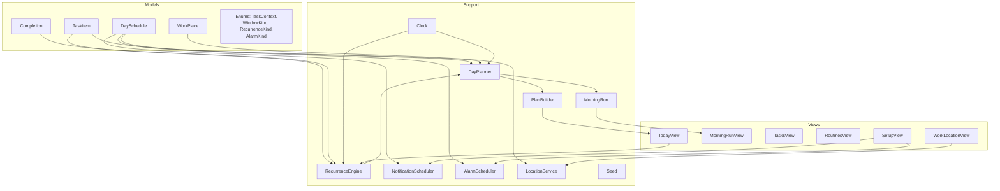

# Architecture

## The idea the code is shaped around

Most to-do apps are a list that asks *when?* about every item. Yetsa inverts
that: the week has a **scaffold** of fixed points — alarm, out of bed, leave
home, arrive, lunch, knock off, bed — and the gaps between them are **windows**
with a measurable capacity. Tasks are poured into windows. The app never asks
when, because it already knows the shape of the day.

Every number on screen falls out of that one idea. "15 min free" is a window's
capacity minus what is planned against it. "2 min behind" is the clock left
before the door minus the work left to do. Nothing is stored that can be
derived.

## Layers

```
Yetsa/
  Models/     Persistent types and the enums that drive behaviour
  Support/    Pure logic and system integration. No SwiftUI views.
  Views/      SwiftUI only. Reads models, calls into Support, draws.
```

The rule that keeps it honest: **Support knows nothing about Views, and Views
contain no scheduling arithmetic.** When a view needs a number it asks the
planner for it.



## How a day gets built

1. `PlanBuilder` finds the `DaySchedule` for that weekday.
2. `DayPlanner` turns the schedule's minute marks into `DayAnchor`s and
   `DayWindow`s, in order.
3. `RecurrenceEngine` is asked, for every task, whether it is due that day.
4. Due tasks are poured into windows — the one they asked for, or the first
   that accepts their context.
5. The result is a `DayPlan`: anchors, windows, a timeline, and the quota
   tasks owed that week.

`DayPlan` is a value type built fresh on each render. Nothing about a day is
persisted; it is recomputed from the scaffold and the task list every time,
which means a change to the scaffold reshapes history as well as the future.

## Persistence

SwiftData, local only. `ModelConfiguration(cloudKitDatabase: .none)`.

There is **no networking code in the app at all** — no URLSession, no API
client, no analytics. The only thing that leaves the device is nothing. The
one place that touches Apple's servers is the map search on the work-location
screen, which is MapKit's own call and carries no Yetsa data.

## System integration

| Concern | Framework | Why this one |
| --- | --- | --- |
| Reminders | UserNotifications | Scheduled relative to scaffold anchors, not clock times, so Friday follows Friday without a second setting |
| Alarms | AlarmKit (iOS 26) | Sounds through silent mode and a Focus; a notification does neither, and you cannot be woken by something a Focus suppresses |
| Arrival | CoreLocation `CLMonitor` | Region monitoring is marked for deprecation; `CLMonitor` persists and wakes the app for a crossing |
| Place search | MapKit `MKLocalSearch` | A coordinate typed from memory makes a geofence that silently never fires |

## Decisions worth knowing

**Minutes from midnight, not `Date`, for the scaffold.** A `DaySchedule` stores
`345` rather than a date. Times survive timezone changes and compare cheaply,
and "half past six" means half past six wherever you are.

**Recurrence is anchored, not counted.** Fortnightly laundry is "every 2 weeks,
Saturday, counting from this date" — not "every 14 days". Skip one and the
rhythm holds instead of sliding onto Sundays.

**Quotas are a count, not a date.** Cooking twice a week is a debt to the week,
not two tasks that go overdue.

**Monochrome.** One red, used only where something is wrong. Colour-coding
seven window kinds was the first design and it read as decoration, because
position already carried the information.

**The icon is generated.** `Tools/MakeIcon.swift` writes the PNGs, so the shape
lives in one place rather than in a binary nobody can edit.

## Known gaps

Tracked as issues rather than hidden here: no automated tests, no CI, no data
export, no widget. See the project board.
