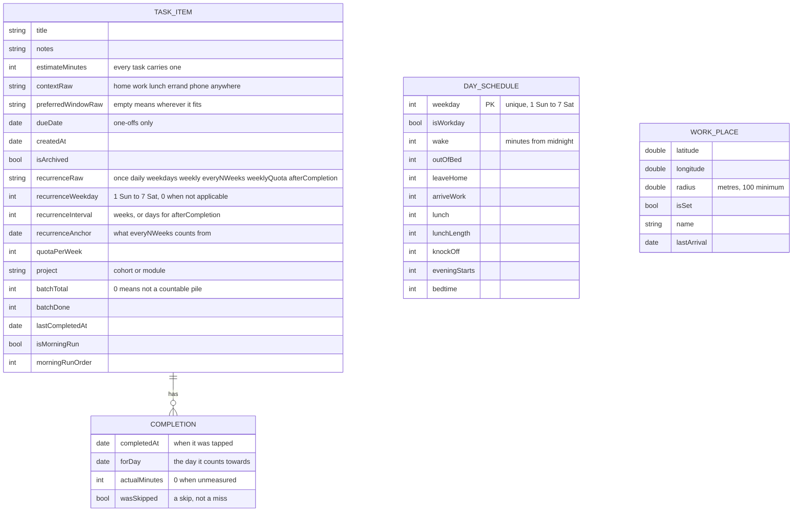

# Entity relationship diagram

Four entities in a local SwiftData store. One relationship.

## Why it is shaped this way

**`TaskItem` → `Completion` is the only relationship**, cascade delete, with
`Completion.task` as the inverse. Everything about history lives in completions
rather than as flags on the task, which is what makes "how many times did I
cook this week" and "what does this actually take" answerable.

**`forDay` is separate from `completedAt`.** Ticking last night's dishes at
00:20 belongs to yesterday. Without the split, every late tick would break a
streak.

**`wasSkipped` is not a deletion.** A skipped laundry Saturday keeps the
fortnightly rhythm intact and stays out of quota counts. Three states —
untouched, done, skipped — not two.

**`DaySchedule` has exactly seven rows**, one per weekday, enforced by
`@Attribute(.unique)` on `weekday`. They are seeded on first launch and only
ever edited.

**`WorkPlace` has at most one row**, created lazily the first time Setup is
opened, so an install that never uses the geofence carries no location data at
all.

**Enums are stored as raw strings**, not integers, with a `stored(_:)` fallback
on each. A value that is no longer recognised degrades to a sensible default
rather than crashing or silently becoming the wrong case.

**Everything has a default value.** SwiftData needs them for lightweight
migration, so a new field can be added without a migration plan.
