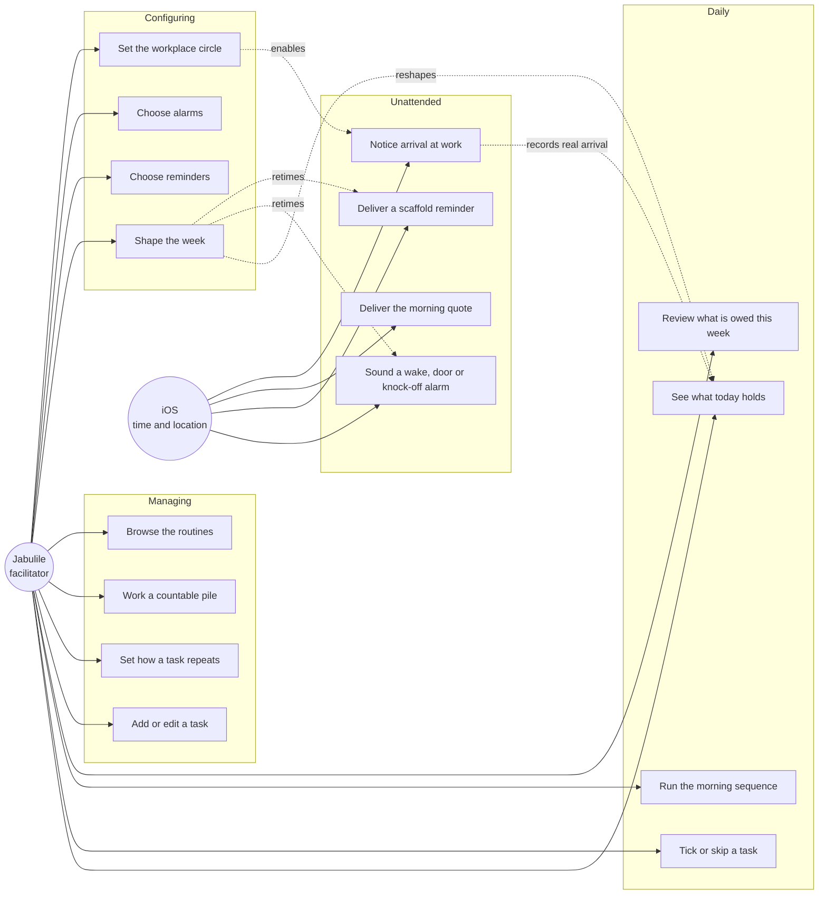

# Use cases

Two actors. The person, and the system — because a good deal of what Yetsa does
happens while nobody is holding the phone.

## The ones worth spelling out

### See what today holds
The home screen. Windows as sections, scaffold points as footers, and a strip
of free-time figures so the evening is visible without scrolling. Windows
already behind you collapse to one line each.

### Run the morning sequence
An ordered checklist measured against the door rather than the clock. The
number it reports is **slack** — time left minus work left — so it says "2 min
behind" instead of making you do the arithmetic half awake.

### Set how a task repeats
Seven kinds. The two that matter are **every few weeks**, anchored to a real
date so skipping one does not shift the weekday, and **a few times a week**,
which is a count owed rather than a date missed.

### Shape the week
The single screen everything else derives from. Change Friday's knock-off and
the windows, the budgets, the reminders and the alarms all follow. This is why
it is the only screen that ever needs correcting when life changes shape.

### Sound an alarm
Three: wake, leave home, knock off. Only the wake-up can be snoozed, and the
snooze is capped — switching it on also schedules an unsnoozable alarm at the
out-of-bed time, so the chain cannot run past the buffer.

### Notice arrival at work
A geofence round the workplace. Crossing in records the real arrival and says
how it compared to the assumption on the scaffold. Working days only, once a
day, silent.

## Out of scope, deliberately

No accounts, no sharing, no sync, no collaboration. One person, one phone. The
moment any of those arrive, so does a server, and the app stops being something
that works on a plane.
